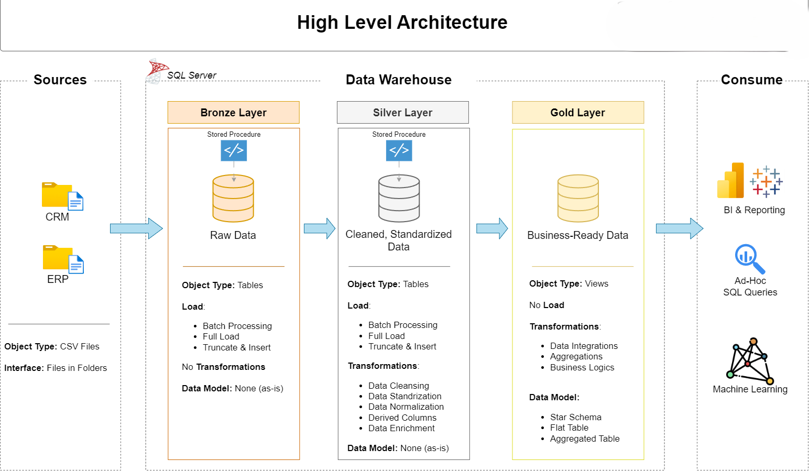
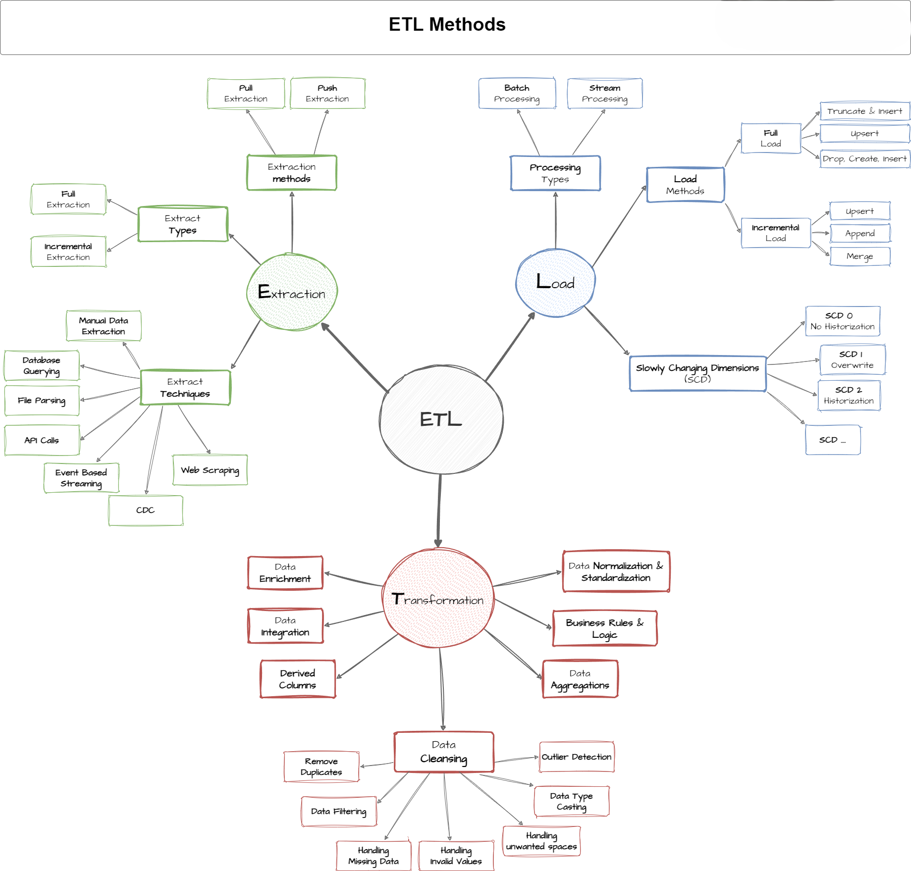

# Data Warehouse and Analytics Project

A SQL Server data warehouse built on the **Medallion Architecture** (Bronze → Silver → Gold). It ingests raw CRM and ERP exports from CSV, cleanses and standardizes them, and exposes a business-ready star schema for reporting and analytics.

Designed as a portfolio project, it highlights industry best practices in data engineering and analytics.

---

## 🏗️ Data Architecture



| Layer | Object type | Load strategy | Purpose |
|-------|-------------|---------------|---------|
| **Bronze** | Tables | Full load (truncate & insert) via `BULK INSERT` | Raw data, stored as-is from the source CSV files |
| **Silver** | Tables | Full load (truncate & insert) from Bronze | Cleansed, standardized and normalized data |
| **Gold** | Views | None (computed on read) | Business-ready star schema for reporting and analytics |

The ETL techniques used throughout the project are summarized below:



---

## ⭐ Data Model (Gold Layer)

| Object | Type | Description |
|--------|------|-------------|
| `gold.dim_customers` | Dimension | One row per customer, combining CRM customer info with ERP demographics (birthdate, gender) and location (country). |
| `gold.dim_products` | Dimension | One row per active product, enriched with ERP category, subcategory and maintenance data. Historical product versions are excluded. |
| `gold.fact_sales` | Fact | One row per sales order line, linked to `dim_customers` and `dim_products` via surrogate keys (`customer_key`, `product_key`). |

---

## 📂 Repository Structure

```
sql-data-warehouse/
├── datasets/
│   ├── source_crm/                  # CRM exports: cust_info, prd_info, sales_details
│   └── source_erp/                  # ERP exports: CUST_AZ12, LOC_A101, PX_CAT_G1V2
├── docs/
│   ├── data_architecture.png        # High-level architecture diagram
│   ├── ETL.png                      # Overview of ETL techniques and methods
│   └── naming_conventions.md        # Naming guidelines for schemas, tables, columns and procedures
├── scripts/
│   ├── init_database.sql            # Creates the DataWarehouse database and schemas
│   ├── bronze/                      # Bronze DDL + load procedures (CRM, ERP)
│   ├── silver/                      # Silver DDL + cleansing/transformation procedure
│   └── gold/                        # Gold star-schema views
├── tests/
│   ├── quality_checks_silver.sql    # Data quality checks for the Silver layer
│   └── quality_checks_gold.sql      # Integrity checks for the Gold layer
├── LICENSE
└── README.md
```

---

## 🚀 Getting Started

### Prerequisites

- **[SQL Server](https://www.microsoft.com/en-us/sql-server/sql-server-downloads)** (Express or Developer edition is fine; 2017 or later)
- **[SQL Server Management Studio (SSMS)](https://learn.microsoft.com/en-us/sql/ssms/download-sql-server-management-studio-ssms)** or any other SQL client

### 1. Get the data onto the SQL Server host

The Bronze load procedures read the CSV files from `C:\sql-data-warehouse\datasets\`. Clone the repository to that location on the machine running SQL Server:

```powershell
git clone https://github.com/SDormans/sql-data-warehouse.git C:\sql-data-warehouse
```

If you clone it elsewhere, update the `FROM '...'` paths in `scripts/bronze/proc_load_bronze_crm.sql` and `scripts/bronze/proc_load_bronze_erp.sql`. The SQL Server service account needs read access to the folder.

### 2. Create the database and objects

Run the scripts in this order:

| Step | Script | What it does |
|------|--------|--------------|
| 1 | `scripts/init_database.sql` | ⚠️ Drops and recreates the `DataWarehouse` database with `bronze`, `silver` and `gold` schemas |
| 2 | `scripts/bronze/ddl_bronze_crm.sql`<br>`scripts/bronze/ddl_bronze_erp.sql` | Creates the Bronze tables |
| 3 | `scripts/bronze/proc_load_bronze_crm.sql`<br>`scripts/bronze/proc_load_bronze_erp.sql` | Creates the Bronze load procedures |
| 4 | `scripts/silver/ddl_silver.sql` | Creates the Silver tables |
| 5 | `scripts/silver/proc_load_silver.sql` | Creates the Silver load procedure |
| 6 | `scripts/gold/ddl_gold.sql` | Creates the Gold views |

### 3. Load the data

```sql
USE DataWarehouse;

EXEC bronze.load_bronze_crm;
EXEC bronze.load_bronze_erp;
EXEC silver.load_silver;
```

The Gold layer consists of views, so it is up to date as soon as Silver is loaded.

### 4. Verify data quality

Run `tests/quality_checks_silver.sql` and `tests/quality_checks_gold.sql`. Each check documents its expectation in a comment; checks marked *Expectation: No results* should return zero rows.

---

## 📋 Project Requirements

### Building the Data Warehouse (Data Engineering)

**Objective:** Develop a modern data warehouse using SQL Server to consolidate sales data, enabling analytical reporting and informed decision-making.

- **Data Sources**: Import data from two source systems (ERP and CRM) provided as CSV files.
- **Data Quality**: Cleanse and resolve data quality issues prior to analysis.
- **Integration**: Combine both sources into a single, user-friendly data model designed for analytical queries.
- **Scope**: Focus on the latest dataset only; historization of data is not required.
- **Documentation**: Provide clear documentation of the data model to support both business stakeholders and analytics teams.

### BI: Analytics & Reporting (Data Analysis)

**Objective:** Develop SQL-based analytics to deliver detailed insights into:

- **Customer Behavior**
- **Product Performance**
- **Sales Trends**

These insights empower stakeholders with key business metrics, enabling strategic decision-making.

---

## 🛡️ License

This project is licensed under the [MIT License](LICENSE). You are free to use, modify, and share this project with proper attribution.
